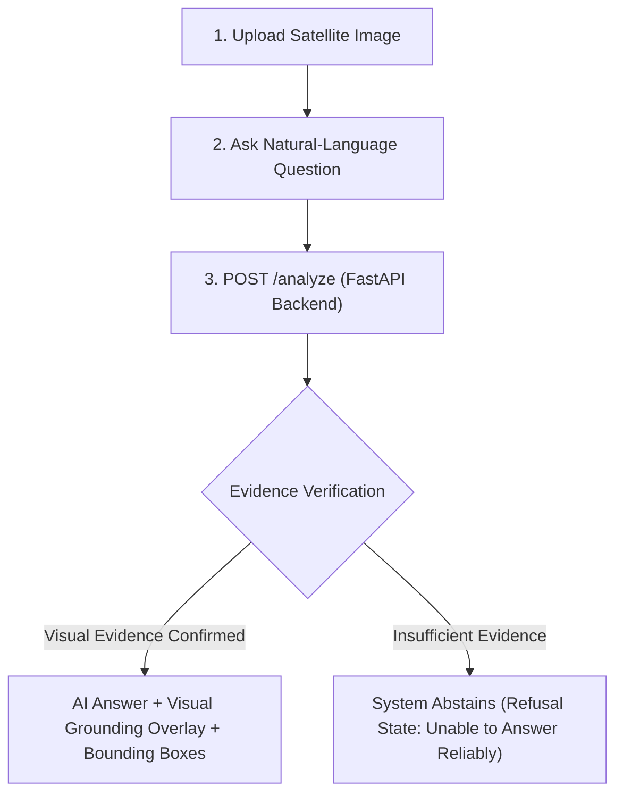

# SatQuery AI — Remote-Sensing Vision-Language Assistant

> **Problem Statement ST-09 (ISRO / Space-Technology Hackathon)**  
> *Ask natural-language questions about satellite imagery and get evidence-grounded answers.*

SatQuery AI is a functional geospatial vision-language analysis workstation designed for high-resolution satellite and aerial imagery. It bridges natural language visual question answering (VQA) with visual evidence grounding and refusal/abstention mechanisms to prevent hallucinated answers when imagery is ambiguous, occluded, or sub-resolution.

---

## Architecture Overview

```
satquery-ai/
├── frontend/                  # React + Vite geospatial analysis workstation UI
│   ├── src/
│   │   ├── components/        # ImageViewer, AskSatQuery, ResultsDisplay, QueryInspector
│   │   ├── services/          # API communication layer (connects to FastAPI backend)
│   │   ├── App.jsx            # Main geospatial workstation workflow
│   │   └── index.css          # Modern dark-neutral geospatial theme
│   ├── .env.example           # Environment template
│   ├── package.json
│   └── vite.config.js
├── backend/                   # FastAPI high-performance inference server
│   ├── app/
│   │   ├── api/routes.py      # POST /analyze and GET /health endpoints
│   │   ├── schemas/           # Pydantic response and object detection models
│   │   ├── services/          # Qwen/ZoomEarth VLM & grounding services
│   │   └── main.py            # FastAPI entry point with CORS
│   ├── requirements.txt
│   └── .venv/                 # Python virtual environment
├── tests/
│   └── test_api.py            # API unit tests
├── README.md
└── .gitignore
```

---

## Core ST-09 Workflow



1. **Step 1: Upload Satellite Image**: Users upload real RGB satellite/aerial imagery (PNG, JPG, TIFF). Displays actual image dimensions and metadata.
2. **Step 2: Ask a Question**: Natural-language question interface with example prompts (*"Are there any buildings visible?"*, *"How many buildings are visible?"*, *"Are there roads in the image?"*).
3. **Step 3: Analyze Image**: Sends multipart form-data to the backend VLM & visual grounding pipeline.
4. **Step 4: View Answer & Visual Evidence**:
   - **AI Answer**: Exact grounded answer from the remote-sensing vision-language model.
   - **Visual Evidence**: High-resolution evidence image with bounding box overlays localized by the grounding model.
   - **Detections**: Regions breakdown with exact confidence scores and coordinates.
5. **Abstention Protocol**: If evidence is insufficient, the system safely abstains with:
   > **Unable to answer reliably**  
   > *The available visual evidence is insufficient to support a reliable answer.*

---

## Quickstart Guide

### Prerequisites
- **Node.js**: v18+ (tested on Node v20/v26)
- **npm**: v9+
- **Python**: 3.10+ (for backend development)

---

### Step 1: Run the React Frontend

1. Navigate to the frontend directory:
   ```bash
   cd satquery-ai/frontend
   ```

2. (Optional if needed) Install dependencies:
   ```bash
   npm install
   ```

3. Set up the environment file (defaults to live Cloudflare backend):
   ```bash
   cp .env.example .env
   ```

4. Start the Vite development server:
   ```bash
   npm run dev
   ```

5. Open your browser and navigate to:
   ```
   http://localhost:5173
   ```

---

### Step 2: (Optional) Run the Local FastAPI Backend

The frontend connects directly to the live backend URL (`https://honor-proceed-olympus-eleven.trycloudflare.com`). To run the backend locally:

1. Navigate to the backend directory:
   ```bash
   cd satquery-ai/backend
   ```

2. Activate virtual environment and start FastAPI:
   ```bash
   uvicorn app.main:app --host 127.0.0.1 --port 8000 --reload
   ```

3. Verify backend:
   - Health check: `http://127.0.0.1:8000/health`
   - API Docs: `http://127.0.0.1:8000/docs`

---

## API Specification

### `GET /health`
Returns system and model availability:
```json
{
  "status": "healthy",
  "zoomearth": true,
  "grounding": true
}
```

### `POST /analyze`
Accepts `multipart/form-data`:
- `image`: Satellite image file (PNG, JPG, TIFF)
- `question`: Natural language question string

#### Grounded Response Example
```json
{
  "question": "Are there any buildings visible?",
  "answer": "Yes, several residential and commercial buildings are clearly visible across the central sector.",
  "targets": ["building"],
  "evidence_found": true,
  "detections": [
    {
      "label": "building",
      "score": 0.267,
      "box": [397.0, 746.5, 521.5, 931.5]
    }
  ],
  "abstained": false,
  "evidence_image": "BASE64_ENCODED_PNG"
}
```

#### Abstention Response Example
```json
{
  "question": "Are there any buildings visible?",
  "answer": "I cannot provide a reliable answer because the requested visual evidence was not sufficiently detected in the image.",
  "targets": ["building"],
  "evidence_found": false,
  "detections": [],
  "abstained": true,
  "evidence_image": "BASE64_ENCODED_PNG"
}
```
